# TryOutGit
# Git & GitHub Learning Log (TryOutGit)

A step-by-step record of how I practiced branching, branch protection rules, Pull Requests (PRs), and resolving merge conflicts.

---

## 1. Initial Project Setup & Pushing to GitHub
**Screenshots:** 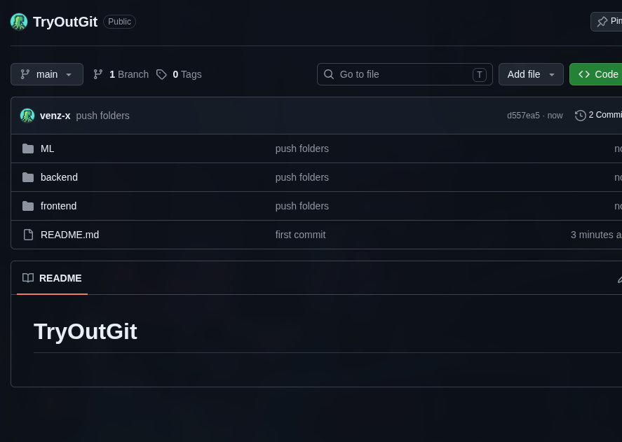 (VS Code setup) & 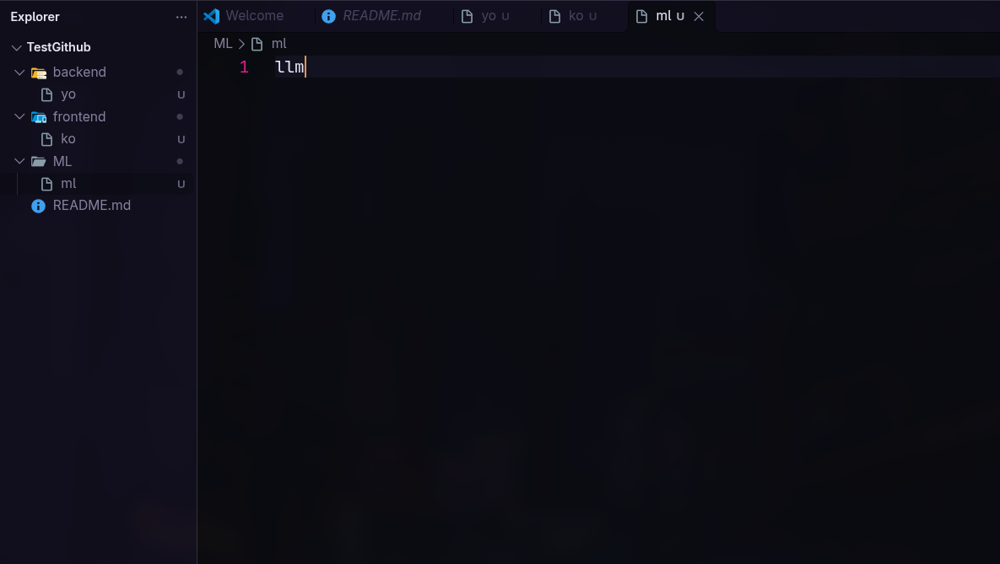 (GitHub repo)

**What I did:**
I created a project folder (`TestGithub`) with three subdirectories (`backend/yo`, `frontend/ko`, and `ML/ml` containing `llm`) and pushed the files to my `TryOutGit` repository on the `main` branch.

**Commands used:**
```bash
git init
git add .
git commit -m "push folders"
git branch -M main
git remote add origin [https://github.com/venz-x/TryOutGit.git](https://github.com/venz-x/TryOutGit.git)
git push -u origin main
```

## 2. Locking (Protecting) the main Branch
Screenshots: 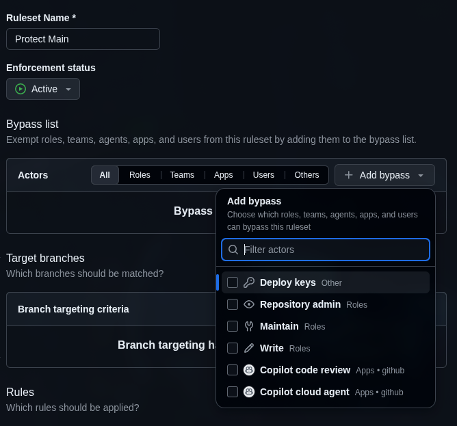, 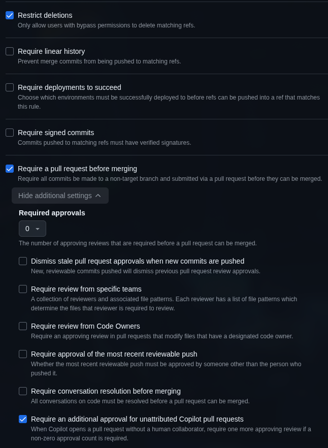

What I did:
To prevent anyone (including myself) from pushing code directly to main without a Pull Request, I configured a Branch Ruleset on GitHub:

Went to Settings -> Rulesets -> Rulesets -> New branch ruleset.

Named the rule Protect Main and set Enforcement status to Active.

Removed Repository admin from the Bypass list so the rule blocks me too.

Set Target branches to Include default branch (main).

Checked Restrict deletions and Require a pull request before merging (with Required approvals set to 0 for solo testing).


## 3. Creating a Feature Branch & Pushing Changes
Screenshots: 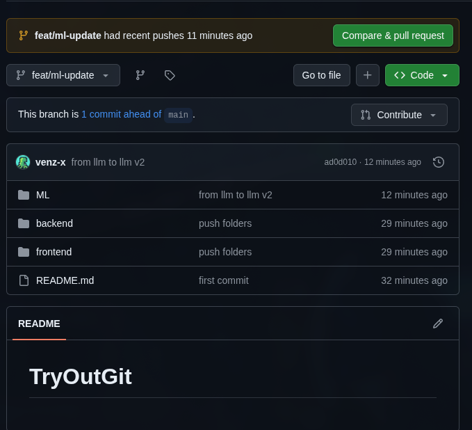

What I did:
Instead of working on main, I created a separate feature branch called feat/ml-update.

I edited ML/ml from llm to llm v2, committed the change, and pushed the branch to GitHub.

```bash
# Create and switch to a new branch
git checkout -b feat/ml-update

# Stage, commit, and push changes to GitHub
git add .
git commit -m "from llm to llm v2"
git push
```

## 4. Testing the main Branch Lock & Resetting HEAD
Screenshot: 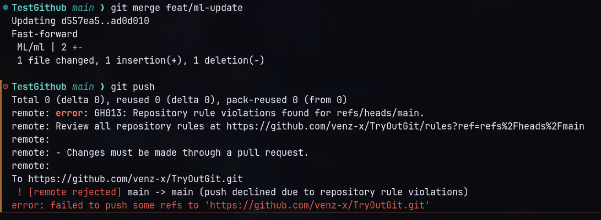 | 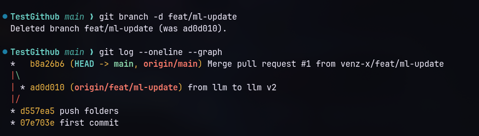

What I did:
I wanted to see what happens if I try to merge locally and push directly to main without a Pull Request.

Git allowed the local merge, but GitHub blocked the git push with
error GH013: Repository rule violations found — Changes must be made through a pull request.

I then reset my local main branch (HEAD) back to match GitHub's origin/main.

Commands used:

```bash
# Switch to main and merge locally
git checkout main
git merge feat/ml-update

# Try pushing directly to main (Blocked by GitHub ruleset!)
git push

# Undo the local merge so local main matches GitHub's main again
git reset --hard origin/main

# View branch pointers and where HEAD is sitting
git log --oneline --graph --all
```

## 5. Opening, Reviewing, and Merging a Pull Request

What I did:
I clicked Compare & pull request on GitHub for feat/ml-update, verified that all checks passed (Ready to merge), and clicked Merge pull request. Then I pulled the updated main branch down to VS Code and deleted the old feature branch.

Commands used:

```bash
# Pull the newly merged changes from GitHub into local main
git checkout main
git pull origin main

# Delete the local feature branch after merging
git branch -d feat/ml-update
```


## 6. Simulating & Resolving a Merge Conflict
Screenshots: 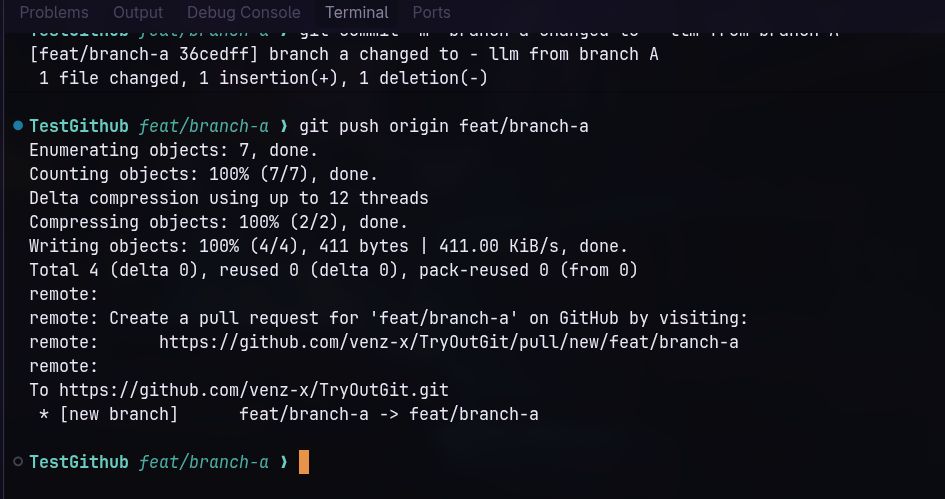, 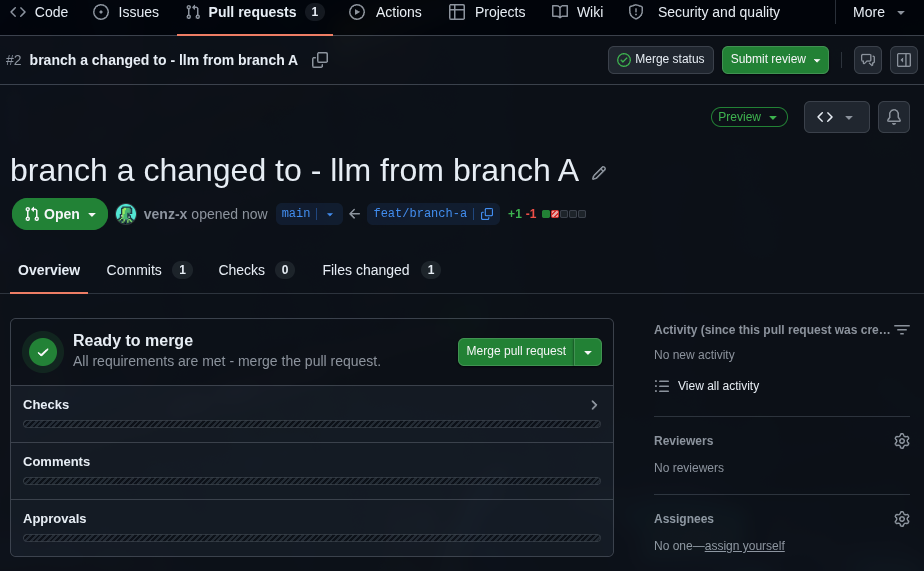, 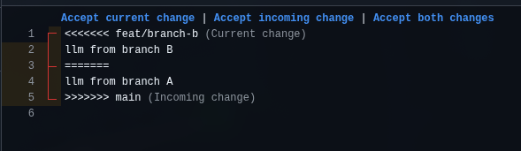, 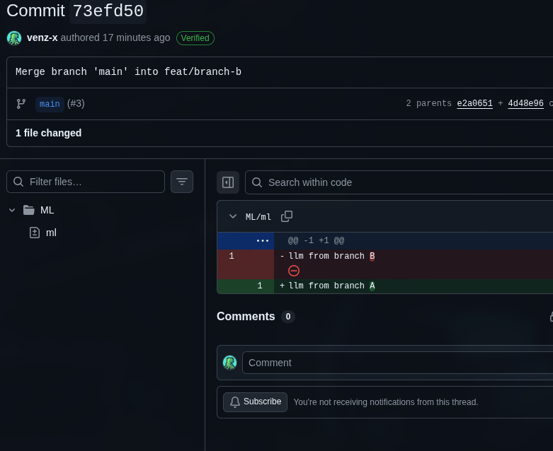, 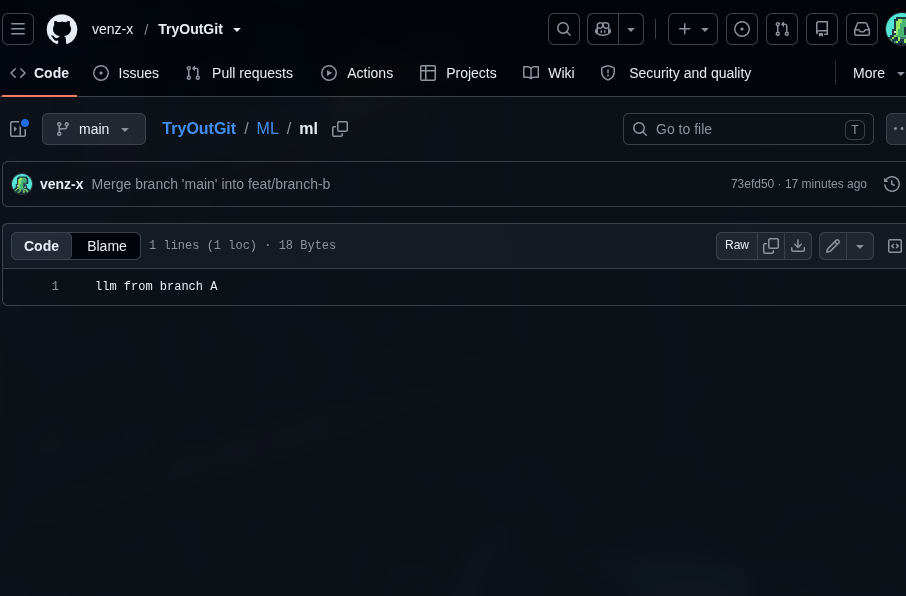,

What I did:
I simulated two branches editing the exact same line (Line 1 of ML/ml) from the same starting point (llm v2):

Created feat/branch-a, changed Line 1 to llm from branch A, pushed, and merged its PR into main on GitHub.

Switched back to my local main (without pulling the new changes) and created feat/branch-b.

Changed Line 1 to llm from branch B and pushed. This caused a Merge Conflict because main on GitHub already had llm from branch A.

Pulled origin/main into feat/branch-b to bring the conflict into VS Code.

Saw how VS Code's conflict buttons work:

Accept current change (HEAD): Keeps the branch my terminal is currently sitting on (feat/branch-b).

Accept incoming change: Keeps the branch I am pulling in (main, which had feat/branch-a's text).

Accept both changes: Stacks both lines one after another.

Commands used:

```bash
# S1: Create Branch A, edit ML/ml, and push (then merge PR on GitHub)
git checkout main
git checkout -b feat/branch-a
git add ML/ml
git commit -m "branch a changed to - llm from branch A"
git push origin feat/branch-a

# S2: Go back to local main (without git pull) and create Branch B
git checkout main
git checkout -b feat/branch-b
git add ML/ml
git commit -m "branch b edit"
git push origin feat/branch-b

# S3: Pull updated main into Branch B to trigger conflict in VS Code
git pull origin main

# S4: After clicking an Accept option in VS Code and saving ML/ml
git add ML/ml
git commit -m "Merge branch 'main' into feat/branch-b"
git push
```